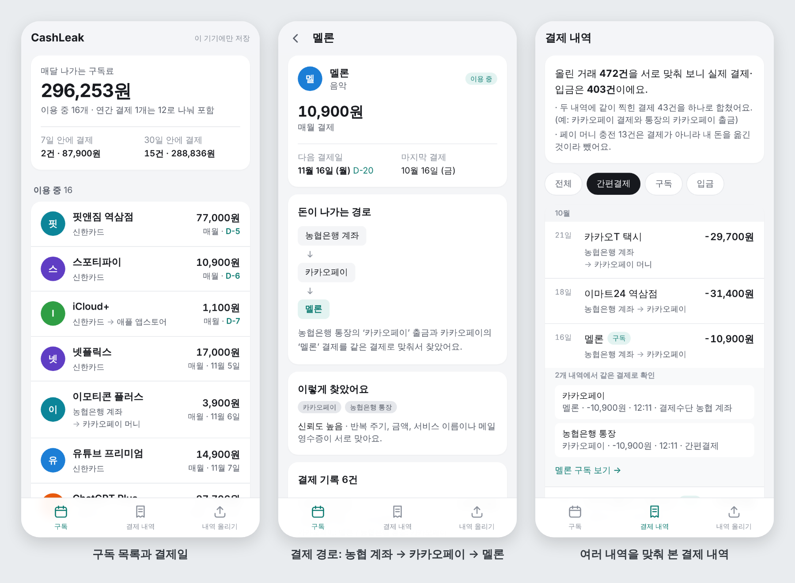

# CashLeak

매달 조용히 빠져나가는 정기 구독을 찾아 정리하는 웹앱입니다.
통장·카드·간편결제 거래내역과 Gmail·네이버메일 영수증을 함께 보고, 직접 등록하지 않아도 구독 목록과 다음 결제일, 돈이 나간 경로(예: 농협은행 계좌 → 카카오페이 → 멜론)를 보여 줍니다.



<sub>화면의 데이터는 모두 가상 데이터입니다.</sub>

## 진행 상황

| 단계 | 내용 | 상태 |
|---|---|---|
| 1 | 탐지 엔진을 가상 데이터로 검증 | 완료 |
| 2 | 웹앱 기본 틀: 내역 올리기, 구독 목록, 수정, 여러 내역 교차검증, 로그인(Supabase) | 완료 (가상 데이터와 실제 내역 2종으로 확인) |
| 3 | 메일(IMAP) 수집을 앱에 연결 | 예정 |
| 4 | 배포와 마무리 | 예정 |

실제 거래내역 파일은 토스뱅크 거래내역과 카카오페이 머니 거래내역(둘 다 비밀번호가 걸린 엑셀)으로 확인했습니다. 다른 은행·카드사 파일은 아직 확인하지 않았습니다.

## 주요 기능

- **여러 내역 한꺼번에 올리기**: 통장, 카드, 간편결제(카카오페이·네이버페이 등) 내역 파일(엑셀 .xlsx, CSV)을 여러 개 올립니다. 머리글을 보고 어떤 내역인지 판별하고, 파일 이름으로 은행·카드사를 추측합니다. 같은 파일을 다시 올려도 중복으로 들어가지 않고, EUC-KR로 저장된 CSV도 읽습니다.
- **비밀번호 걸린 엑셀**: 은행·간편결제 앱이 내려 주는 엑셀은 보통 생년월일 비밀번호가 걸려 있습니다. 비밀번호를 넣으면 브라우저 안에서 암호를 풀어 읽고, 비밀번호는 저장하지 않습니다.
- **결제 경로 찾기**: 간편결제로 결제하면 통장에는 "카카오페이"로, 카카오페이 내역에는 "멜론"으로 찍힙니다. 두 기록을 같은 결제로 합쳐 한 번만 세고, 돈이 어디서 나와 어디를 거쳐 갔는지 보여 줍니다.
- **구독 자동 탐지**: 한 달(또는 1년) 간격으로 반복되는 결제를 찾고, 메일 영수증과 맞춰 서비스 이름, 금액, 다음 결제일, 해지 여부를 정합니다.
- **직접 고치기**: 금액·주기·다음 결제일 수정, 해지 표시, 숨기기, 탐지되지 않은 구독 직접 추가.
- **저장 방식 두 가지**: 설정이 없으면 이 브라우저에만 저장합니다. Supabase를 연결하면 이메일과 비밀번호로 로그인하고, 본인 행만 읽고 쓸 수 있게 막아 둔(행 수준 보안) DB에 저장합니다. [설정 방법](docs/supabase.md)

올린 파일은 브라우저 안에서 읽고 분석합니다. 원본 파일과 엑셀 비밀번호는 어디에도 올리지 않으며, Supabase 모드에서는 정리된 거래 행과 메일 내용이 DB에 저장됩니다.

## 동작 방식

탐지는 `packages/engine`에 있고, 브라우저와 Node 양쪽에서 같은 코드가 돕니다.

1. **파일 읽기** (`src/io/`)
   - 엑셀(.xlsx)은 zip 안의 XML에서 셀 값만 꺼냅니다. 날짜 서식이 걸린 숫자는 날짜로 바꿉니다.
   - 비밀번호가 걸린 엑셀은 MS 복합 문서 안에 암호화되어 있어, 복합 문서를 풀고 [MS-OFFCRYPTO]의 표준·에자일 암호화(AES + SHA-1/SHA-2)를 풉니다. 토스뱅크 내역은 표준, 카카오페이 머니 내역은 에자일 방식이었습니다.
   - 머리글 위의 안내 줄(조회기간 등)은 건너뛰고, 예금주 이름(토스뱅크의 '성명')과 같은 상대와 오간 돈이나 카카오페이 머니의 '내계좌로 내보내기'는 내 계좌끼리 옮긴 돈으로 보고 소비에서 뺍니다.
2. **여러 내역 맞추기** (`src/reconcile.ts`)
   - 간편결제 내역의 결제마다 통장·카드 내역에서 짝을 찾습니다. 금액이 같고, 결제수단이 맞고(계좌 결제는 통장, 카드 결제는 카드), 통장·카드 쪽 가맹점명이 그 간편결제이거나 실제 가맹점이어야 합니다. 시각이 둘 다 있으면 10분 이내, 없으면 같은 날이나 하루 차이까지 인정하고 가장 가까운 것을 고릅니다.
   - 짝지은 기록은 한 건으로 합치고 경로를 남깁니다: `농협은행 계좌 → 카카오페이 → 멜론`, `신한카드 → 네이버페이 → 네이버플러스 멤버십`.
   - 페이 머니 충전은 내 돈이 자리만 옮긴 것이라 소비에서 빼고, 머니로 낸 결제는 가장 최근에 충전한 계좌를 출처로 봅니다 (`농협은행 계좌 → 카카오페이 머니 → 이모티콘 플러스`). 그 통장 내역을 올리지 않았어도 머니 내역에 충전 은행이 적혀 있으면(카카오페이 머니의 '은행' 열) 그 계좌로 봅니다.
   - 통장과 카드 내역에 모두 찍힌 체크카드 결제는 하나만 셉니다.
3. **반복 결제 찾기** (`src/detect/recurring.ts`)
   - 가맹점명을 정규화해 같은 곳끼리 묶습니다 (뒤에 붙는 승인번호, `(주)` 같은 표기 제거, 알려진 서비스는 별칭으로 통일).
   - 같은 기준일 ±3일에 한 달 또는 1년 간격으로 결제됐는지 봅니다. 31일 결제가 짧은 달에 말일로 당겨지는 것, 주말·공휴일로 밀리는 것도 처리합니다.
   - 애플(`APPLE.COM/BILL`)처럼 한 가맹점에 구독이 여러 개면 금액별로 나누고, 해외 결제는 달러 금액으로 비교합니다.
   - 가격이 오르면 같은 구독의 가격 변경으로 기록하고, 통신비처럼 매달 금액이 다른 자동이체도 찾습니다. 다만 카탈로그에 없는 가맹점에서 금액이 한 번에 두 배 넘게 바뀌면 가격 변경으로 보지 않습니다. 예정일이 지나도 결제가 없으면 해지로 추정합니다.
   - 가맹점 표기만 바뀐 구독(예: `주식회사 카카오` → `카카오구독료_카카오페이`)은 앞 묶음이 끝난 바로 다음 차례에 같은 금액으로 이어지고 회사 이름이 같을 때 하나로 잇습니다.
   - 카드대금, 적금·투자 이체, 현금 인출은 분석에서 뺍니다.
4. **메일 영수증 읽기** (`src/email/parse.ts`)
   - 발신 도메인으로 서비스를 식별하고, 비슷한 주소의 피싱 메일은 무시합니다.
   - 구독 표현이 있는 메일만 영수증으로 보고(일반 주문 메일 제외), 금액·주기·다음 결제일을 뽑습니다. 두 메일함에 같은 영수증이 있으면 하나만 남깁니다.
5. **교차검증과 신뢰도** (`src/match/cross-verify.ts`)
   - 거래와 영수증을 금액과 날짜(±3일)로 짝지어, 앱스토어·간편결제·결제대행사로 찍힌 결제가 실제로 어떤 서비스인지 확정합니다.
   - 해지 메일이 있으면 "해지 확인", 결제가 한 번뿐인 연간 구독은 영수증으로 보완합니다.
   - 규칙적으로 반복된 횟수, 주기에 맞지 않는 결제, 금액 변동, 알려진 서비스인지, 메일로 확인됐는지, 같은 곳에서 다른 결제가 많은지(우연일 가능성)를 합쳐 신뢰도를 높음·보통·낮음으로 매깁니다. "낮음"은 앱에서 "구독인지 확인 필요"로 따로 보여 줍니다.

## 실행

Node.js 22.18 이상이 필요합니다 (엔진의 TypeScript 파일을 빌드 없이 실행합니다).

```bash
npm install
npm run dev          # http://localhost:3000
```

첫 화면의 **가상 데이터로 체험하기**를 누르면 데모 사용자의 통장·카드·카카오페이·네이버페이 내역과 메일이 들어갑니다. "내역 올리기" 화면에서 같은 가상 파일을 내려받아 직접 올려 볼 수도 있습니다.

그 밖의 명령 (저장소 루트에서 실행):

```bash
npm test                          # 엔진·웹 단위 테스트
npm run typecheck
npm run build
npm run generate                  # 데모 데이터 → packages/engine/data/sample
npm run detect                    # 명령줄로 탐지 → packages/engine/out/result.md
npm run detect -- data/private    # 내 파일로 탐지 (CSV·엑셀과 emails-*.json을 넣은 폴더)
npm run evaluate -- 300           # 가상 사용자로 정확도 평가 → packages/engine/out/evaluation.md
```

실제 개인 데이터는 `data/private/`에 두세요. 이 폴더는 git에 올라가지 않습니다. 비밀번호가 걸린 엑셀은 환경 변수 `CASHLEAK_PASSWORDS`(쉼표로 여러 개)로 비밀번호를 주면 차례로 넣어 봅니다. 명령에 직접 적으면 셸 기록에 남으니 주의하세요.

Supabase 스키마와 행 수준 보안 시험은 PostgreSQL이 필요해서 CI(`.github/workflows/ci.yml`)에서 돌립니다. 로컬에서는 `PGHOST` 등 접속 환경 변수를 지정하면 `npm test -w @cashleak/web`에 함께 포함됩니다.

## 배포와 아이폰에서 쓰기

Vercel에 올려 씁니다. 분석과 엑셀 암호 풀기는 브라우저 안에서 하므로 거래내역 파일과 비밀번호는 서버로 가지 않습니다.

1. [vercel.com/new](https://vercel.com/new)에서 GitHub 계정으로 로그인하고 이 저장소를 가져옵니다(Import).
2. **Root Directory**를 `apps/web`으로 정합니다. 프레임워크(Next.js)와 설치·빌드 명령은 기본값 그대로 둡니다. 엔진(`packages/engine`)은 Root Directory 밖에 있지만, 기본으로 켜져 있는 "Include source files outside of the Root Directory" 설정 덕분에 함께 빌드됩니다.
3. 환경 변수 없이 배포하면 데이터는 그 브라우저에만 저장됩니다. 여러 기기에서 같이 쓰려면 `NEXT_PUBLIC_SUPABASE_URL`, `NEXT_PUBLIC_SUPABASE_PUBLISHABLE_KEY`를 넣습니다 ([설정 방법](docs/supabase.md)).

그다음부터는 main에 머지할 때마다 다시 배포되고, PR마다 미리보기 주소가 생깁니다.

아이폰에서는 Safari로 배포 주소를 열고 공유 → **홈 화면에 추가**를 누릅니다. 홈 화면 앱은 Safari와 저장 공간이 따로라서, 내역은 홈 화면 아이콘으로 연 앱 안에서 올려야 합니다. 배포 주소는 누구나 열 수 있지만, 브라우저 저장 모드에서는 각자 기기에만 저장되므로 다른 사람이 내 내역을 볼 수 없습니다.

## 구조

```
apps/web/               Next.js 웹앱 (아이폰 홈 화면에 추가해 쓰는 용도)
  app/                  화면: 구독 목록, 구독 상세, 결제 내역, 내역 올리기
  lib/files.ts          파일 판별·읽기·중복 제거
  lib/view.ts           탐지 결과와 사용자 수정을 합쳐 화면용 데이터로
  lib/store/            저장소: 브라우저(localStorage) / Supabase
packages/engine/        탐지 엔진 (의존성: 엑셀 압축 풀기 fflate, 암호 풀기 @noble/hashes·@noble/ciphers)
  src/reconcile.ts      여러 내역 맞추기, 결제 경로
  src/detect/           반복 결제 탐지
  src/email/            메일 영수증 파서
  src/match/            거래·영수증 교차검증, 신뢰도
  src/io/               CSV·엑셀(비밀번호 포함) 읽기, 통장·카드·간편결제 내역 가져오기
  sim/                  가상 데이터 생성기와 채점
  scripts/              generate / detect / evaluate
  data/sample/          데모 사용자 데이터와 정답(truth.json)
  test/fixtures/        비밀번호 걸린 엑셀 시험 파일(가상 데이터)과 만드는 스크립트
supabase/migrations/    DB 스키마와 행 수준 보안 정책
supabase/tests/         행 수준 보안 시험
docs/                   평가 결과, 실행 예시, Supabase 설정
```

## 가상 데이터 결과

데모 사용자(구독 18개, 함정 데이터 포함)는 17개를 찾았습니다. 놓친 티빙은 결제 1건에 영수증이 없어 원리상 찾을 수 없는 경우입니다. 실행 결과 예시는 [docs/sample-result.md](docs/sample-result.md)에 있습니다.

가상 사용자 301명(데모 1명 + 무작위 300명) 평가, 전체 결과는 [docs/evaluation.md](docs/evaluation.md):

| 지표 | 값 |
|---|---|
| 재현율 (찾을 수 있는 구독 기준) | 100% |
| 재현율 (전체, 흔적이 부족한 구독 포함) | 93.7% |
| 재현율: 간편결제 내역도 올린 경우 (235명) | 94.7% |
| 재현율: 통장·카드만 올린 경우 (66명) | 90.0% |
| 정밀도 (이용 중 + 신뢰도 보통 이상, 앱에서 확정으로 보여 주는 목록) | 100% |
| 정밀도 (해지 추정, 신뢰도 낮음까지 전체) | 97.5% |
| 금액 / 주기 / 상태 정확도 | 100% / 100% / 100% |
| 다음 결제일 (±3일 / 정확히 일치) | 100% / 98.8% |
| 결제 경로 정확도 (구독 1,999개) | 100% |
| 간편결제 ↔ 통장·카드 연결 정밀도 / 재현율 (11,245쌍) | 100% / 100% |

오탐 52건은 모두 신뢰도 "낮음"입니다. 대부분 편의점·서점·택시에서 우연히 한 달 간격으로 비슷한 결제가 반복된 경우이고, 간편결제 내역 없이 통장만 올렸을 때 구독과 구분되지 않는 카카오페이·네이버페이 출금이 11건입니다.

## 한계

- **위 숫자는 실제 정확도가 아닙니다.** 가상 데이터 생성기와 탐지 규칙을 같은 사람이 만들었고 규칙을 이 데이터로 다듬었으므로, 설계한 경우들을 처리한다는 확인일 뿐입니다.
- 실제 내보내기 파일은 토스뱅크 거래내역과 카카오페이 머니 거래내역만 확인했습니다. 다른 곳의 파일은 머리글 이름으로 열을 찾기 때문에 이름이 다르면 읽지 못할 수 있습니다. 예전 엑셀 형식(.xls)과 PDF는 읽지 못합니다.
- 간편결제 내역 없이 통장·카드만 올리면, 페이로 낸 구독은 "카카오페이" 같은 이름으로만 보이고(메일로 확인되면 서비스 이름이 나옴), 페이 머니로 낸 구독은 통장에 흔적이 없어 찾지 못합니다.
- 포인트와 계좌를 섞어 낸 결제처럼 금액이 나뉜 결제는 아직 맞추지 못합니다.
- 메일은 아직 가상 메일(JSON 파일)만 읽습니다. 실제 메일함 연결은 3단계에서 합니다. 메일 파서는 규칙 기반이라 가상 템플릿에 맞춰져 있습니다.
- Supabase 저장은 로컬 PostgreSQL과 시험용 클라이언트로만 확인했고, 실제 Supabase 프로젝트에서는 아직 돌려 보지 않았습니다.
- 브라우저 저장 모드의 데이터는 그 브라우저에만 남고, 나중에 Supabase로 옮기는 기능은 없습니다.
- 서비스 카탈로그는 18개입니다. 카탈로그에 없는 가맹점도 반복 패턴으로 찾지만 이름은 가맹점명 그대로 나옵니다.
- 결제 1건에 메일도 없으면 원리상 찾을 수 없습니다. 연간 구독은 데이터 기간 안에 결제나 갱신 안내 메일이 없으면 찾지 못합니다 (평가에서 Microsoft 365 100건 중 44건).
